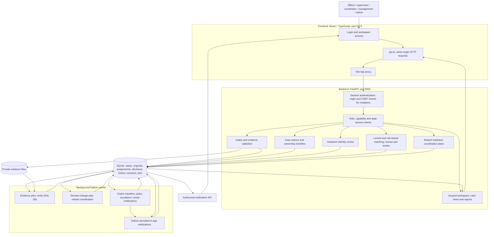
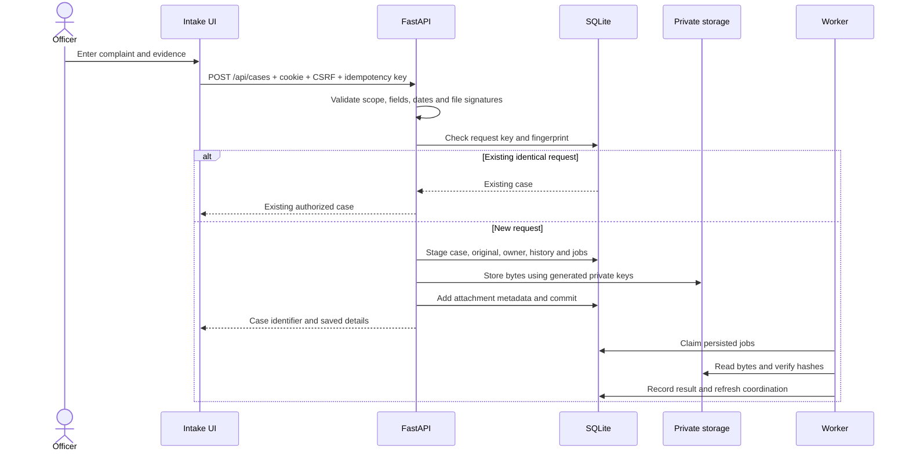

# Samanvay technical workflow

Source-based description of the checked-out application, 28 October 2026. Paths below are relative to the repository root. This describes the implemented local synthetic prototype.

## 1. Runtime architecture

Three processes run together:

| Component | Where | Responsibility |
| --- | --- | --- |
| React + TypeScript UI, served by Vite | `frontend/src/`, port 5173 | Login, intake, work queue, case actions, institution views, matching review, coordination, notifications and reports |
| FastAPI, served by Uvicorn | `backend/app/main.py` → `api.py`, port 8000 | Authentication, authorization, validation, business rules and database transactions |
| Python worker | `backend/app/worker.py` | Polls approximately every two seconds for evidence checks, domain changes, scheduling and in-app notification delivery |
| SQLite through SQLAlchemy | `.local-data/samanvay.sqlite3` | Persistent cases, sessions, permissions, history, jobs and notifications |
| Private filesystem storage | `.local-data/private-evidence/` | Uploaded bytes under generated storage keys; database holds attachment metadata and SHA-256 hashes |

Vite proxies browser requests from `/api` to `http://127.0.0.1:8000`, keeping browser traffic on one origin. Both API and worker use the same persistent database. Alembic manages schema migrations; `app.seed` adds synthetic accounts and initial data.

Arrows show logical data flow, not a mandatory order between independent features. Matching is requested through the API; the background worker does not run the matching algorithm.

## 2. Login and request protection

1. `app/Login.tsx` submits credentials to `POST /api/auth/login`.
2. `api.py` and `auth.py` verify the Argon2 password hash and persist an opaque session. The browser receives an HttpOnly session cookie and a CSRF token in the session response.
3. `app/useSession.ts` manages the frontend session. `GET /api/auth/session` restores it on load.
4. Protected endpoints resolve the session and memberships. Mutating endpoints also validate origin and `X-CSRF-Token`.
5. `policies.py` and workflow capability checks determine which records and actions the user may access. Read access distinguishes M (metadata), N (narrative), I (complainant identity), and A (attachments).
6. `case_views.py` projects only permitted fields. Session failures return 401; permission failures commonly return 403 or a scoped 404.

## 3. Intake: from form to durable complaint

**Entry:** `frontend/src/features/cases/IntakePage.tsx` → `POST /api/cases` in `backend/app/api.py`.

1. The officer enters complaint details, selects a canonical fictional institution and optionally attaches evidence. Institution lookup can help resolve an identifier/name/alias before confirmation.
2. The frontend submits multipart data containing JSON, files and an `Idempotency-Key`.
3. The backend validates the schema, synthetic marker, dates, intake membership and regional scope.
4. `storage.py` validates file signatures/extensions and sizes: up to three PDF, PNG, JPEG or UTF-8 TXT files, each at most 5 MiB. It computes SHA-256 hashes.
5. A content fingerprint ties the request key to its content. Repeating the same key and content returns the existing case; different content with that key returns 409.
6. The API creates a `CaseRecord`, immutable `OriginalSubmission`, `Complainant`, initial `Assignment`, workflow events, attachment metadata, intake request record and outbox jobs. The intake officer becomes the accountable owner immediately; the initial lifecycle is `RECEIVED`.
7. File bytes are stored under random private keys. The database transaction commits the records. On a handled failure, it rolls back and removes files written by that attempt. Files and SQLite are separate storage systems, so this is compensating cleanup rather than a single filesystem/database transaction.
8. The response supplies the case identifier and authorized details. Durable jobs allow background work after the HTTP response.

## 4. Case processing and ownership

**UI:** `features/cases/CaseDetailPage.tsx`, `screens/WorkflowScreens.tsx`.

**Execution path:** `workflows.py` HTTP endpoint → `application/case_actions.py` use case → `domain/case_actions.py` pure decision rules → `infrastructure/case_actions.py` SQL repository.

The HTTP layer checks authority. The repository builds a snapshot including lifecycle, information responses, pending transfer and evidence permissions. The domain layer decides whether the command is valid. The repository performs a conditional version update and saves action/history/resolution records in a transaction.

```mermaid
stateDiagram-v2
    [*] --> RECEIVED: Intake; initial owner recorded
    RECEIVED --> ASSIGNED: Eligible same-bureau reassignment
    ASSIGNED --> ASSIGNED: Further eligible reassignment
    UNDER_REVIEW --> ASSIGNED: Eligible same-bureau reassignment
    AWAITING_INFORMATION --> ASSIGNED: Eligible same-bureau reassignment
    RECEIVED --> UNDER_REVIEW: REVIEW
    ASSIGNED --> UNDER_REVIEW: REVIEW
    UNDER_REVIEW --> AWAITING_INFORMATION: REQUEST_INFORMATION
    AWAITING_INFORMATION --> AWAITING_INFORMATION: INFORMATION recorded
    AWAITING_INFORMATION --> UNDER_REVIEW: REVIEW after latest request answered
    RECEIVED --> DISPOSED: Authorized DISPOSE
    ASSIGNED --> DISPOSED: Authorized DISPOSE
    UNDER_REVIEW --> DISPOSED: Authorized DISPOSE
    AWAITING_INFORMATION --> DISPOSED: Authorized DISPOSE
    DISPOSED --> UNDER_REVIEW: Authorized REOPEN with next action
```

The diagram reflects implementation, including disposal from any active state and reassignment resetting an active case to `ASSIGNED`. Disposal requires a resolution, appropriate supervisor capability and no pending transfer. Reopening requires senior-management role plus explicit capability. Deadline, escalation, amendment and next-action commands have separate guards; they do not necessarily change lifecycle. Amendments preserve original submissions.

**Concurrency:** updates carry `expected_version`. The database update succeeds only if that version still matches. A conflict returns 409 so the user reloads current state. This prevents silently overwriting another user's work.

**Transfer:** `POST /api/cases/{id}/transfers` creates a pending request for an eligible named officer in another bureau. The source owner stays accountable while pending. Acceptance changes owner/bureau and closes/opens assignment intervals atomically with the decision. Rejection, cancellation or expiry leave ownership with the source. Transfer status is separate from lifecycle.

## 5. Institution identity, matching and coordination

These are separate workflows:

| Workflow | Trigger and processing | Saved result |
| --- | --- | --- |
| Institution identity | `GET /api/identity/lookup` checks exact ID, normalized names/recorded aliases and city conflicts; an authorized identity action confirms or corrects the institution | Canonical institution link and `IdentityDecision` history |
| Complaint matching | `POST /api/cases/{id}/matching` checks confirmed identity and review/source permissions; selects at most 50 permitted cases from the same institution; ranks lexical overlap and structured facts | `RelationshipSuggestion` with proposed label, evidence and source fingerprint |
| Human relationship review | Reviewer confirms, rejects or defers; API verifies permissions, source versions and fingerprint | `RelationshipDecision`; previous decisions remain preserved |
| Institution coordination | Confirmed institution has active cases in at least two current bureaus; deterministic refresh runs through domain jobs and scheduling, and selected coordination API paths | `CoordinationGroup` and case participants |
| Coordination planning | Authorized coordinator reviews group, names eligible lead, next action and due date | Versioned group state and `GroupReview` history |

Matching labels are `DUPLICATE`, `RELATED`, `INDEPENDENT` and `UNKNOWN`. A shared institution alone does not establish duplication. Rankings are signals, not probabilities. The active implementation is `lexical-rules-v1.1`; no LLM or semantic model is connected. The character-vector experiment is retained only in the evaluation harness and is disabled in the application.

Coordination normally moves `REVIEW_REQUIRED → IN_REVIEW → PLANNED → RESOLVED`, with supported re-review/defer actions. Deferral records a review while retaining the current state. A plan requires an eligible active named lead. Coordination can be required even when the complaints are independent. Neither relationship decisions nor coordination lead selection changes case ownership or merges complaints.

## 6. Worker, scheduling and notifications

`worker.py` executes these activities in its loop:

1. **Evidence integrity:** claim eligible `EVIDENCE_INTEGRITY` jobs with a lease; compare stored bytes to attachment hashes; record verification or retry/failure. This verifies byte integrity, not malware safety or truthfulness.
2. **Domain changes:** consume `DOMAIN_CHANGED` jobs and deterministically refresh institution coordination in a transaction.
3. **Scheduler:** expire pending transfers; apply enabled policy escalation after deadlines; refresh coordination; create permission-scoped notifications for pending actions, approaching deadlines, overdue cases, workflow events, coordination and relationship review.
4. **Delivery:** process up to 20 eligible notifications per loop; mark them delivered in the database. Notification delivery uses leases and bounded retries. Scheduler keys prevent repeated creation of the same effect.
5. **UI:** `GET /api/notifications` retrieves permitted notifications; acknowledgement is a separate write.

Notifications are in-app only. The worker sends no email or SMS. Policy/context time governs scheduling; ordinary local mode uses current time, while explicitly created isolated demo contexts support controlled time.

## 7. Reads, dashboards and reports

- `workspace.py`: authorize the population, select open/overdue/mine, order by earliest due date with undated cases later, and return up to 12 queue items plus scoped counts.
- `case_views.py`: build authorized case details, histories, assignments and permitted evidence links.
- `coordination.py`: provide institution timelines and scoped coordination views.
- `reporting.py`: derive reports from one authorized population before filters, totals and exports; serve JSON, escaped CSV and printable HTML.
- Pending means lifecycle other than `DISPOSED`. Overdue is an active case with a due time earlier than context time. Under-review and overdue counts overlap other pending counts.
- Received-date filters use Asia/Kolkata boundaries. Current-state reports and period event reports have different meanings; a backlog disposal count can exceed new receipts in the same period.

## 8. Storage map

| Concern | Principal tables/models |
| --- | --- |
| Organization and access | `User`, `Membership`, `Region`, `Bureau`, `AccessGrant`, `CapabilityGrant` |
| Institution identity | `Institution`, `InstitutionAlias`, `IdentityDecision` |
| Case and original evidence | `CaseRecord`, `Complainant`, `OriginalSubmission`, `Attachment`, `IntakeRequest` |
| Accountability and workflow | `Assignment`, `WorkflowEvent`, `CaseAction`, `Transfer`, `Resolution` |
| Pair review | `RelationshipSuggestion`, `RelationshipDecision` |
| Shared institution work | `CoordinationGroup`, `GroupParticipant`, `GroupReview` |
| Operations | `LoginSession`, `LoginAttempt`, `OutboxJob`, `AdministrativePolicy`, `AdministrativeEvent`, `SchedulerEffect`, `Notification`, `SecurityAudit`, `DemoContext` |

Exact schema: `backend/app/models.py` and `backend/migrations/`. Private evidence downloads pass independent attachment authorization before returning bytes.

## 9. Supporting paths outside the normal complaint workflow

- `app.demo`: isolated synthetic contexts, storage auditing, backup and restore into a new context.
- `evaluation/`: frozen synthetic corpus and reproducible matcher experiments; this is separate from live complaint processing.
- `backend/tests/` and `frontend/tests/`: automated validation of implemented behavior.
- `?preview=1`: loads `PreviewApp.tsx`, a separately labeled illustrative interface with fixtures; it does not save live records.

No official AICTE service, external messaging, production identity provider or connected semantic model participates in the current runtime. SQLite and local files are the actual persistence layer.
